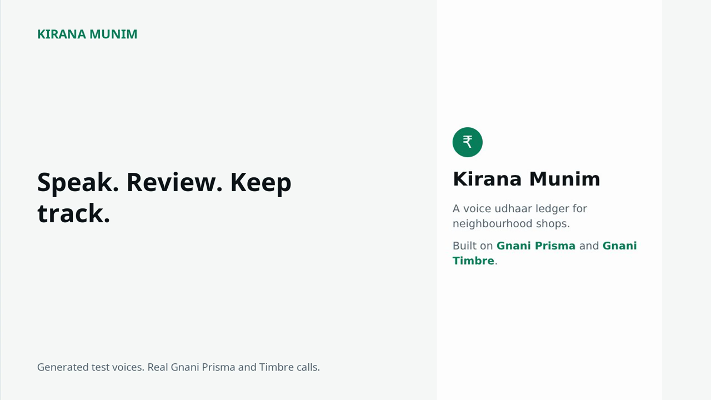
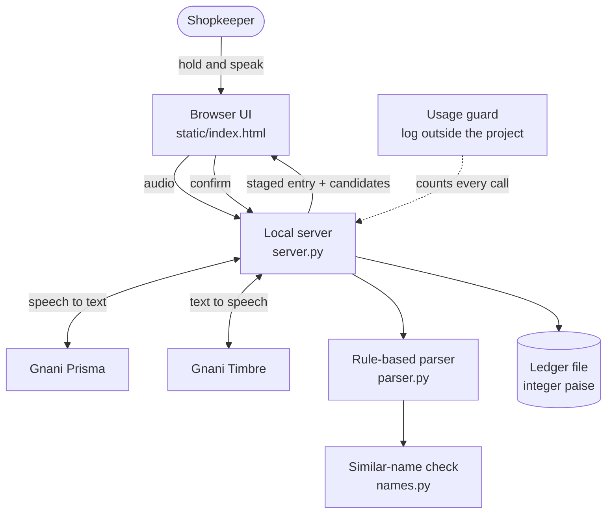
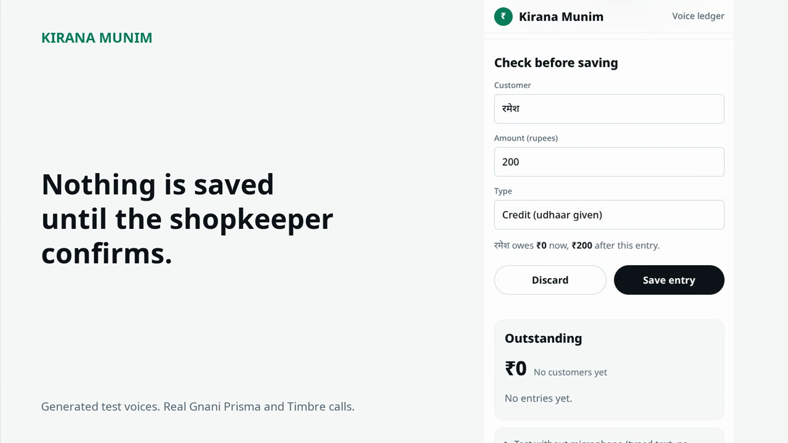
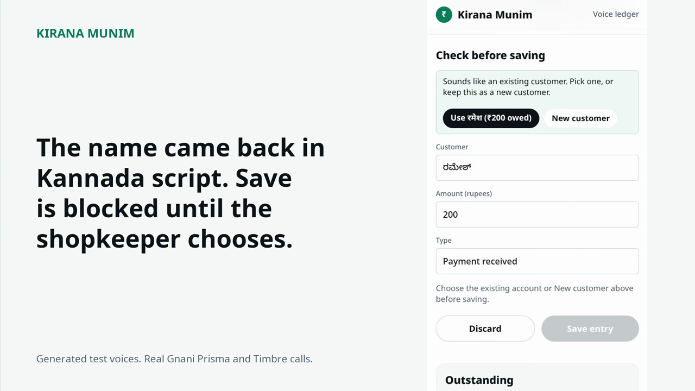
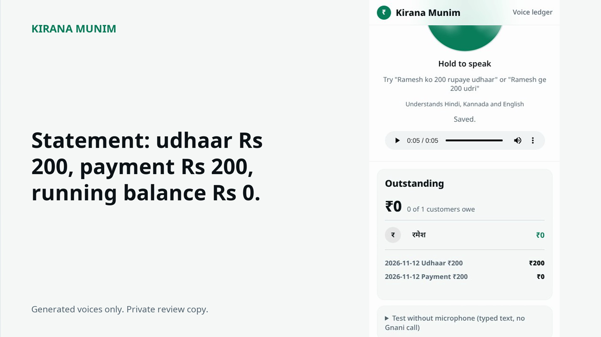
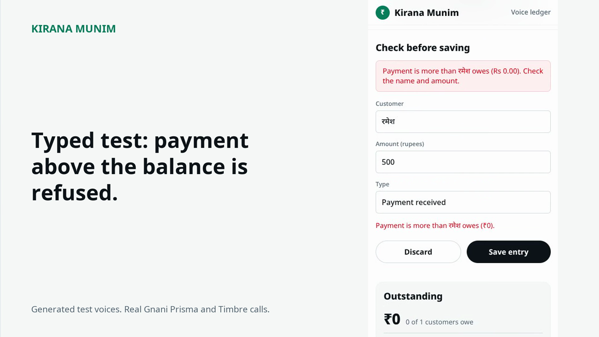

# Kirana Munim

A voice udhaar (credit) ledger for neighbourhood shops, built on Gnani Prisma (speech to text) and Gnani Timbre (text to speech).

The shopkeeper holds a button and says one entry in Hindi, Kannada or English, for example "Ramesh ko 200 rupaye udhaar". The app shows the proposed entry for review and reads it back. Nothing is saved until the shopkeeper confirms.

## Demo video

[](https://anilkumara9.github.io/kirana-munim/)

Click the image to play the video in the browser (about 2 minutes). The file is also in the repo: [docs/demo.mp4](docs/demo.mp4). It was recorded from the running app with real Gnani calls. The spoken inputs are generated test speech, the narrator is a separate generated voice, and the app's reply is a third voice. A headless browser with a fake microphone file was used, so physical microphone capture is not shown. Script: [docs/DEMO_SCRIPT.md](docs/DEMO_SCRIPT.md). One-page summary: [docs/one-page-pitch.pdf](docs/one-page-pitch.pdf).

## System design



Details, request sequence and safety rules: [docs/ARCHITECTURE.md](docs/ARCHITECTURE.md).

## Screens

| 1. Voice entry staged for review | 2. Similar name needs a choice |
| --- | --- |
|  |  |

| 3. Statement with running balance | 4. Overpayment refused |
| --- | --- |
|  |  |

## What it does

- Speech to entry with Gnani Prisma, using the language hint `kn-IN,hi-IN,en-IN`, and a rule-based parser for name, amount and kind.
- Spoken read-back with Gnani Timbre.
- Review before saving. Unclear entries block Save. A payment larger than the balance is refused.
- Similar-name suggestion across Latin, Devanagari and Kannada script (for example Ramesh and रमेश). It is only a suggestion. Save stays blocked until the user picks the existing account or chooses New customer, and the server enforces this.
- Customer statement with a running balance, and a reminder text you can copy. Nothing is sent automatically.
- Money is stored as integer paise.

## Status and limits

- Tested with computer-generated test speech for Hindi and Kannada: speech to entry, spoken reply, save, restart persistence, payment settling.
- Not tested: real human voices, physical microphones, noisy shops, other languages, more than one shop or user. This is a local single-user demo with no login, cloud or sync.
- Prisma can mis-hear number words, so the review step is the safeguard.
- Name matching is a coarse rule-based sound key. It can miss variants and can group different people (Sunil and Sonal), so every match is the user's decision.

## Run

Requirements: Python 3.10+ (standard library only for the app), `ffmpeg` on PATH, Chrome or Chromium. Browser tests also need `pip install playwright`. They use your installed Chrome, and `CHROME_PATH` overrides its location.

1. Get a Gnani API key from your own Gnani account. Never put it in a file in this folder or commit it.
2. Set it in your shell without echoing it: `read -rs GNANI_API_KEY && export GNANI_API_KEY`
3. `python3 server.py`, then open http://127.0.0.1:8000 and allow the microphone.

Without a key the app still starts. Speech requests return a "not configured" message, and the typed test box, which makes no Gnani call, still works. Ledger data goes to `ledger.json` next to the code (override with `LEDGER_PATH`).

## Usage guard

Every Gnani call is counted in `~/.kirana-munim/usage_log.json` (override with `KIRANA_USAGE_LOG`), outside the project. A call is counted before the request is sent and stays counted if it fails. Limits: 200 s of audio, 6000 TTS characters, 100 calls, no automatic retries. This is a local safeguard, not a vendor limit. Gnani's dashboard is the source of truth for credits.

## Tests

No Gnani call: `python3 tests/test_parser.py`, `test_names.py`, `test_ui.py`, `test_audio_path.py`, `test_mic_path.py`, `test_cancel.py`, `test_hint.py`, `test_usage_guard.py`.

Real Gnani calls (use credits, need the key): `tests/live_e2e.py FIXTURE.wav OUTDIR`, `tests/gen_demo_assets.py`, `tests/record_demo.py OUTDIR`, then `tests/mux_demo.py OUTDIR`.

## Project layout

```
server.py          HTTP server and request flow
gnani_client.py    Gnani Prisma and Timbre calls, usage guard
parser.py          rule-based entry parser
names.py           cross-script name key
ledger.py          ledger, staging, confirm rules
static/index.html  UI (orb control with WebGL and CSS fallback)
tests/             automated tests and demo tooling
docs/              architecture, demo video, screens, one-page pitch
```

## Contribution note

The code, demo and documents were produced with an AI assistant for Anil Kumara. The speech models inside the app are Gnani Prisma and Timbre only. No other AI model runs in the app.
