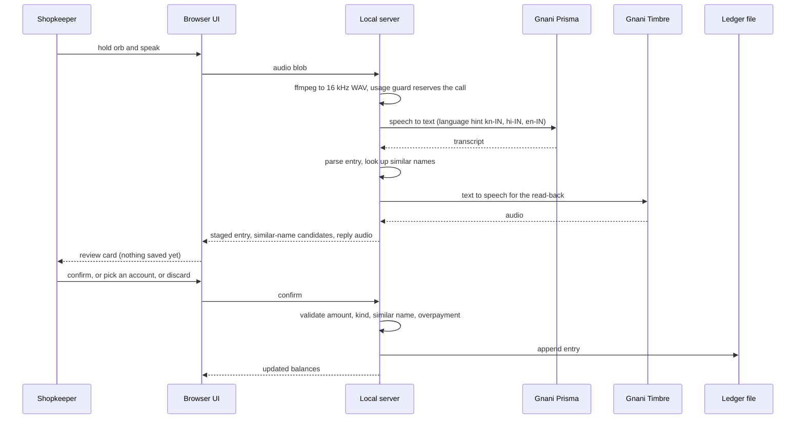

# Architecture

## Components

| Part | File | Role |
| --- | --- | --- |
| Browser UI | `static/index.html` | Single page. Hold-to-speak orb (WebGL with CSS fallback), review card, balances, statements. Records audio with MediaRecorder and calls the local server. |
| HTTP server | `server.py` | Python standard library only. Routes `/` (UI), `/parse` (typed test, no vendor call), the speech route, `/confirm`, `/ledger`. Converts browser audio to WAV with ffmpeg. |
| Gnani client | `gnani_client.py` | Calls Gnani Prisma (speech to text) and Timbre (text to speech). Holds the cumulative usage guard. Key comes from `GNANI_API_KEY` only. |
| Parser | `parser.py` | Rule-based. Reads customer, amount and kind (credit, payment, sale) from the transcript, including Hindi and Kannada number words. Anything unclear becomes an issue that blocks Save. |
| Name key | `names.py` | Consonant-skeleton key so the same name in Latin, Devanagari or Kannada script can be suggested as one customer. |
| Ledger | `ledger.py` | Append-only JSON file. Money in integer paise. Holds pending (staged) entries in memory until confirmed. |

## Request flow

## Safety rules

- Nothing is written until the user confirms. Staged entries live in memory and are dropped on discard or restart.
- A name that sounds like an existing customer in another spelling or script is only a suggestion. `ledger.confirm` refuses to save such a name until the user picks the existing account or sends `new_customer`. The check runs on the server, so it holds even if the UI is bypassed.
- A payment larger than the balance is refused.
- Amounts are integer paise. No floating point in money math.
- The usage guard counts every Gnani call before it is sent, keeps the count in `~/.kirana-munim/usage_log.json` outside the project, never retries, and stops at 200 s of audio, 6000 TTS characters or 100 calls. It is a local safeguard, not a vendor limit.

## Name matching scope

Devanagari and Kannada consonants are mapped to Latin sound classes. Vowels, `h` and repeated letters are dropped, and two names match only when the skeleton is identical and has at least two letters. The rule is coarse. It can miss spelling variants and can group different people such as Sunil and Sonal, which is why every match is shown as a choice.

## Limits

Local single-user demo. No login, cloud storage or sync. Tested with generated test speech only. Real voices, noisy shops and physical microphones are not tested.
